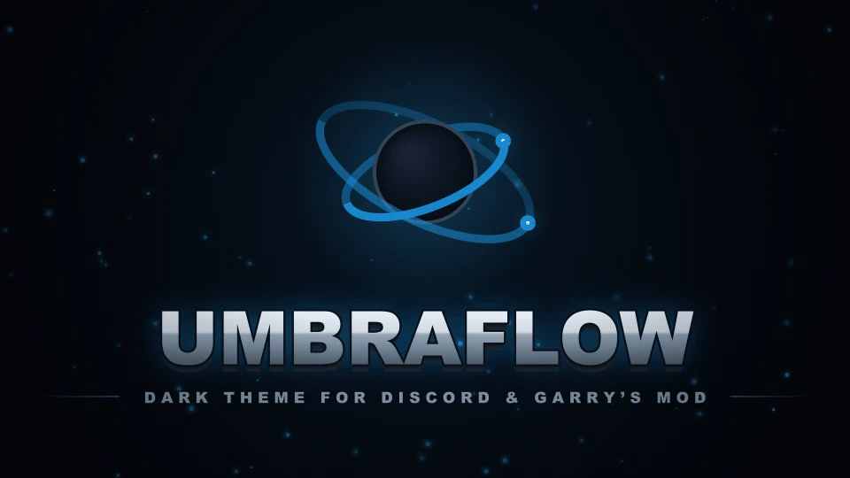
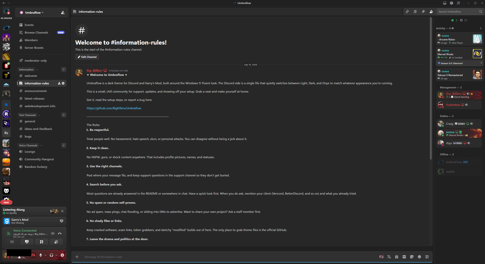
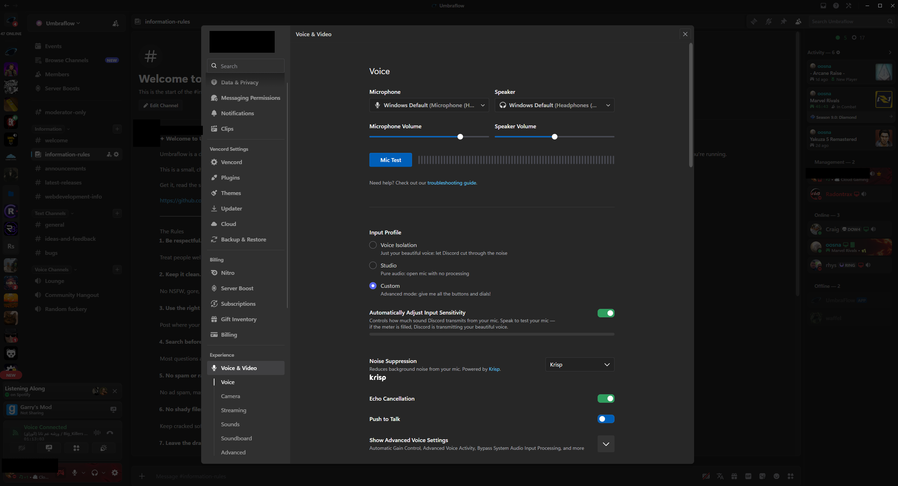

# Umbraflow

Themes for Discord and Garry's Mod, plus a Vencord plugin that animates Discord. Made from scratch.

| Platform | What it does |
|----------|----------------|
| Discord | Restyles the whole client: colors, type and layout across chat, lists, settings, forums and voice calls. One file that follows Discord's Light and Dark setting. |
| Garry's Mod | Themes the main menu, loading screen, VGUI scheme (console, dialogs, spawnmenu), and custom logos. |
| UmbraMotion | A Vencord plugin that animates Discord's UI: menus, modals, popouts, tooltips, messages and more, each spot configurable on its own. |

---

## Features

- The Discord theme is charcoal and blue, set in Ubuntu Sans, with rounded panels and card-based lists.
- It changes itself to match your Discord appearance (Light or Dark). You don't toggle anything.
- The Garry's Mod theme uses Windows 11 Fluent styling: acrylic-style surfaces, rounded corners, and soft shadows.
- The Garry's Mod menu plays a soft hover sound when you mouse over the buttons.
- The Discord theme is a single file with no assets to install. The only thing it loads is the Ubuntu Sans font from Google Fonts, and it falls back to Discord's own font if that can't load.
- UmbraMotion adds enter animations to Discord on top of the theme, with style, speed, easing and direction settings for each part of the UI. Runs on Vencord, works with or without the theme.

---

## Screenshots

| Discord | Garry's Mod |
|---------|-------------|
| <br> |  |

The Discord screenshots show version 1. They have not been retaken for version 2 yet.

---

## Discord

`Discord-Themes/umbraflow.theme.css` restyles Discord's colors, type and layout. Version 2 is a new design, with charcoal surfaces and a blue accent in place of the earlier Fluent look. The Fluent version (1.0.5) is still [in the repo's history](https://github.com/umbraflow-co/UmbraflowDG/blob/8d560b83875bf55b248b4d11fb1d2f2e3747bc16/Discord-Themes/umbraflow.theme.css).

| Area | What changes |
|------|--------------|
| Color | Dark mode uses three charcoal surfaces (`#232323`, `#2b2b2b`, `#333`) with a blue accent. Light mode uses white and pale grey with the same accent. |
| Type | The interface is set in Ubuntu Sans on a 14px scale. |
| Chat | The chat sits in a rounded panel. Each sender's messages carry a thin line on the left, which turns yellow on messages that mention you. The message box is a pill with its tools in a tray. |
| Lists | Channels are pill rows with the icon in a chip, and categories sit in a bubble. The member list groups each role into one card. Direct messages and the friends list are cards too, and the friends tabs are one segmented control. |
| Settings | Each section's rows sit in one card, with pill entries in the sidebar. |
| Forums and threads | Gallery posts are smaller cards that lead with the image. A thread under a message is a card with the link to open it on the right. |
| Voice | The call stage is charcoal instead of black and the controls sit in one tray. The Voice Connected box in the sidebar sits straight on the user panel, with its buttons sharing one row and Disconnect at the end in red. |

The theme uses no blur, animations or transitions.

### Install

Download `Discord-Themes/umbraflow.theme.css` from this repo (or the [Releases](../../releases) page), then pick your client mod:

<details open>
<summary><strong>Vencord</strong></summary>

1. Install [Vencord](https://vencord.dev/).
2. Discord → **Settings** → **Vencord → Themes** → **Open Themes Folder**.
3. Drop `umbraflow.theme.css` into that folder.
4. Enable **Umbraflow** in the Themes list.

If you want it to update itself, skip the download and add this under **Themes → Online Themes** instead:
```
https://raw.githubusercontent.com/umbraflow-co/UmbraflowDG/main/Discord-Themes/umbraflow.theme.css
```
</details>

<details>
<summary><strong>Equicord</strong> (Vencord fork)</summary>

Same as Vencord: **Settings → Equicord → Themes → Open Themes Folder**, drop the file in, enable it. Version 2 has not been tested on Equicord yet.
</details>

<details>
<summary><strong>BetterDiscord</strong></summary>

1. Install [BetterDiscord](https://betterdiscord.app/).
2. Discord → **Settings** → **Themes** → **Open Themes Folder**.
3. Drop `umbraflow.theme.css` into that folder.
4. Toggle **Umbraflow** on in the Themes list.

The file has the metadata header BetterDiscord needs, so it shows up with its name and author. Version 2 was built on Vencord and has not been tested on BetterDiscord yet.
</details>

> If it doesn't show up, reload Discord with **`Ctrl`/`Cmd` + R**, or toggle it off and on.

### Optional Vencord plugins

Three details need a Vencord plugin and do nothing without it:

| Plugin | What it adds |
|--------|--------------|
| MemberCount | Online and total counts above the member list, styled to match. |
| ThemeAttributes | Your own messages get a red line in place of the blue one. |
| Any plugin that adds message box buttons, such as SilentTyping | A hairline separates those buttons from Discord's own. |

### Choosing the look

Go to **Settings → Appearance → Theme** and pick Light or Dark. Switch whenever you want and the palette changes right away. There's no separate Umbraflow setting.

Version 2 has no palette of its own for Onyx, and it has not been tested there.

### How the auto-switch works

Discord puts a class on the app for the current appearance (`theme-light` or `theme-dark`). Umbraflow defines its surfaces once for each class, in two short blocks near the top of the file, then points Discord's own color tokens at them. The layout is written once and shared by both.

---

## UmbraMotion

The theme changes how Discord looks. UmbraMotion changes how it moves. It's a Vencord plugin that plays an enter animation when parts of the UI appear: switching servers or channels, opening menus and popouts, new messages coming in, tooltips, modals, and so on. Thirteen spots in total, and each one has its own style (fade, slide, blur, scale, or slip), duration, easing curve, and direction, so you can tune it or turn off the parts you don't want.

It also respects your OS reduced-motion setting out of the box, and there's a performance mode that disables the two heaviest animations if your machine stutters.

### Install

UmbraMotion is a userplugin, which means it runs on a Vencord built from source rather than the standard installer. Short version:

1. Clone [Vencord](https://github.com/Vendicated/Vencord) and run `pnpm install --frozen-lockfile`.
2. Copy the [`UmbraMotion/`](UmbraMotion/) folder from this repo into Vencord's `src/userplugins/`.
3. `pnpm build`, then `pnpm inject` (quit Discord fully first, from the tray icon).
4. Relaunch Discord and enable **UmbraMotion** under Settings → Vencord → Plugins.

The full walkthrough, plus how the plugin works and how to fix a selector if Discord renames a class, is in [UmbraMotion/README.md](UmbraMotion/README.md).

Works fine with or without the Umbraflow theme. They don't touch each other.

---

## Garry's Mod

The `Gmod-Theme/` folder mirrors your `garrysmod` directory. It has the main menu, loading screen, VGUI scheme (`resource/SourceScheme.res`), chat box font, custom logos, and a hover sound for the menu buttons.

### Requires Chromium

Garry's Mod draws its menu with an embedded browser, and this theme leans on modern CSS (blur, variables, transitions) that only work on GMod's newer **Chromium** engine. On the old Awesomium engine the menu comes out broken and unstyled, so you have to put GMod on a Chromium branch before the theme will look right. It's a one-time Steam setting:

1. In Steam, right-click **Garry's Mod** → **Properties**.
2. Open the **Betas** tab.
3. In the beta dropdown, pick one:
   - **`x86-64`** — the 64-bit build, which runs Chromium by default. Go with this one unless you have a reason not to.
   - **`chromium`** — the 32-bit build with Chromium swapped in.
4. Close the window and let Steam download the update.
5. Launch Garry's Mod once so it's running on Chromium, then install the theme below.

No beta code is needed, both branches are public. If the menu ever shows up plain or half-styled, you're still on Awesomium and haven't switched branches yet.

### Install

**Back up your `garrysmod` folder first.** This replaces core menu files.

1. Open your GMod install, for example `...\Steam\steamapps\common\GarrysMod\garrysmod\`.
2. Copy the contents of `Gmod-Theme/` into that `garrysmod\` folder, merging and overwriting when asked. The `html/`, `resource/`, and `gamemodes/` folders each land in their matching folder.
3. Restart Garry's Mod.

To undo it, restore your backup or verify the game files through Steam.

### Chat and addon text

Server addons (HUDs, F4 menus, scoreboards and plenty of others) mostly draw with Roboto, and GMod's built-in chat box uses bold Verdana. On Windows and Proton both come out heavy. Native Linux draws them lighter, because it ignores bold and falls back to DejaVu Sans, and that's the look the theme copies everywhere:

- GMod's own Roboto files in `resource/fonts/` are replaced with DejaVu Sans under the same names, so addon text that asks for Roboto gets regular-weight DejaVu Sans. Bold Roboto comes out regular too, like on native Linux. Italic Roboto is left as it is.
- The built-in chat box (`resource/ChatScheme.res`) uses regular, smoothed DejaVu Sans.

This applies on every server, to any addon that uses Roboto. Verifying the game files in Steam puts the original Roboto and chat font back.

### Linux and Proton

The theme ships its own fonts for the menu, console and dialogs, so Windows and Linux use the same ones. On Linux you can run GMod two ways.

**Native.** Stay on the `x86-64` branch and turn off Steam Play for Garry's Mod (Properties → Compatibility). For video playback and a newer in-game browser, use [GModPatchTool](https://github.com/solsticegamestudios/GModPatchTool). It patches the stock menu files and checks them before it does, so the order matters:

1. Verify the game files in Steam, so the menu files are stock again.
2. Run GModPatchTool.
3. Copy `Gmod-Theme/` in as described above.

Do the same three steps whenever you rerun the tool.

**Proton.** The theme works the same, including the chat and addon text changes above. If an addon's text shows up in an odd fallback font, it's asking for a Microsoft font Proton doesn't have (Verdana, Trebuchet MS, Impact and so on), and installing them into GMod's Proton prefix fixes that:

```
protontricks 4000 corefonts
```

### Menu sound

Hovering a menu button plays `sound/umbraflow/hover.wav`. Want your own sound? Drop a `.wav` in at that same path and keep the name, and it just works. A short 16-bit wav (mono, 44.1kHz) is the safe bet. If you'd rather point it somewhere else or turn it off, the hover line is at the bottom of `html/js/menu/control.Menu.js`.

---

## Customization

The Discord colors are all CSS variables. The accent colors and the font are in the `:root` block at the top of `umbraflow.theme.css`, and the Dark and Light surfaces are the `.theme-dark` and `.theme-light` blocks right under it. Edit a value and reload. The layout rules read the variables, so one change applies everywhere.

`--umbra-forum-density` in the same `:root` block sets how many forum gallery cards fit per row. 1 is Discord's own size, and higher values fit more, smaller cards.

---

## Community

Questions, updates, or want to show off your setup? Come hang out:

**[discord.gg/umbraflow](https://discord.gg/umbraflow)**

---

## Issues and contributions

Found a bug or have an idea? Open an [issue](../../issues). Pull requests are welcome, just keep things consistent with each theme's look. Run `node tools/check.mjs` before you send one, and see [MAINTENANCE.md](MAINTENANCE.md) for the parts that are easy to break.

---

## License

Umbraflow is under the [MIT License](LICENSE). Use it, change it, and share it, just keep the attribution.

---

## Credits

Created by BigKillers (Discord: `Big_Killers`). Fluent design language from Microsoft / Windows 11. [Ubuntu Sans](https://fonts.google.com/specimen/Ubuntu+Sans) by Canonical, loaded from Google Fonts.

Not affiliated with Discord, Microsoft, or Facepunch Studios.
